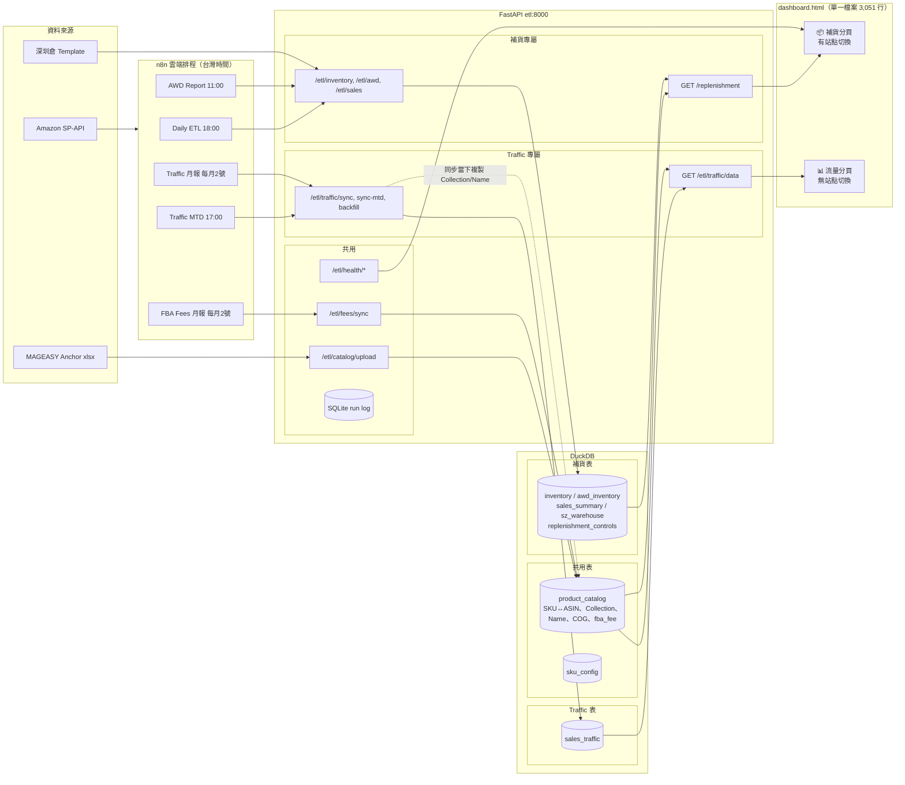

# MAGEASY eCom Dashboard — Traffic 流量分析 功能狀態與交接文件

> 最後更新：2026-10-11
> 環境、Runbook、雲端排程（第 2–4 節）與補貨共用，見 `PROJECT_STATUS_REPLENISHMENT.md`
> 架構細節見 `README.md`，部署見 `DEPLOYMENT.md`
> 本文件第 5 節的數字，來自 2026-10-11 從雲端拉下來的 DB（`pull-cloud-db.sh`）實際查詢結果

---

## 1. 目前狀態總覽

| 項目 | 狀態 |
|---|---|
| Traffic 分頁（圖表、明細表、SKU 成長衰退分析） | 🟡 功能雛形完成，**數字有已驗證的正確性問題**（見第 5 節），團隊暫時不要拿來做決策 |
| 資料同步（月報 / MTD / Backfill） | ✅ 雲端 n8n 自動執行中 |
| US 歷史資料 | ✅ 2024-06 → 2026-10，共 29 個月 |
| UK / DE 歷史資料 | 🟡 只有 2026-09 一個月（尚未 backfill） |
| 多站點切換 | ❌ 尚未支援（三站資料混在一起加總） |
| 與補貨共用資源整合 | 🟡 部分共用，有不一致（見第 6 節） |

---

## 2. 架構圖

**一句話**：Traffic 和補貨共用同一套 n8n → FastAPI → DuckDB → HTML 的管線，共用 `product_catalog`（產品主檔、成本、FBA fee）與 SQLite 執行紀錄；各自有自己的同步端點、資料表和分頁。

---

## 3. 資料來源與指標定義

### `sales_traffic` 表
- 來源：SP-API `GET_SALES_AND_TRAFFIC_REPORT`（by Child ASIN）
- PK：`(data_start_date, data_end_date, child_asin, marketplace_id)`
- 每筆 = 某站點、某 Child ASIN、某個月的流量與銷售
- **MTD 存法**：當月資料存成 `data_end_date = 月底`（實際只涵蓋到昨天），每天覆蓋同一批 row；每月 2 號月報跑完後被完整月資料覆蓋。DB 目前**沒有記錄實際涵蓋到哪一天**
- `sku` / `collection` / `product_name` 是**同步當下**從 `product_catalog` 複製進來的（不會跟著 Anchor 更新）

### 指標定義

| 指標 | 計算 | 備註 |
|---|---|---|
| Sessions | `SUM(sessions)` | |
| Units Sold | `SUM(total_units_ordered)` = B2C + B2B **下單**數 | 與補貨用的 `sales_summary`（**出貨**數）不同，數字本來就會有差，不是 bug |
| Revenue | `SUM(total_ordered_product_sales)` = B2C + B2B 下單金額 | 原幣別，**目前沒存幣別欄位** |
| CVR% | Units ÷ Sessions × 100 | 期間 CVR 一律用總量相除，不平均月 CVR |
| AVG ASP | Revenue ÷ Units | |
| Profit | Revenue − COG×Units − fba_fee×Units − Revenue×15% | 引用費寫死 15%，僅供參考 |
| Margin% | Profit ÷ Revenue | |

---

## 4. 目前功能盤點（`dashboard.html` 流量分頁）

| # | 區塊 | 函式 | 說明 |
|---|---|---|---|
| ① | 篩選列 | `setPreset` / `applyTrafficFilter` / 多選 Collection | 3M / 6M / 12M / 全部、月份區間、Collection 多選 |
| ② | 交叉篩選 | `setCrossFilter` | 點圓餅圖或明細列 → 全頁篩選該 Collection / 產品 |
| ③ | KPI 卡 | `renderTrafficDashboard` | Sessions、CVR、Units、Total Sales、AVG ASP |
| ④ | 月度 Revenue & Profit | `renderMonthlyPL` | 堆疊 Cost + Profit + Margin% 線 |
| ⑤ | MoM 成長率條 | `renderMoMStrip` | 5 指標本月 vs 上月 |
| ⑥ | Revenue / Units 佔比 | `renderPie` ×4 | by Collection、by Name（Top 12） |
| ⑦ | Sessions & CVR 趨勢 | `renderSessionsBar` + `renderCvrPanel` | 上下兩 panel，CVR 有平均線與高低色 |
| ⑧ | Sessions vs Units 趨勢 | `renderCombo` | 雙軸 |
| ⑨ | Sessions by Collection | `renderPie` | |
| ⑩ | 利潤 by Collection | `renderROI` | 堆疊 bar + Margin% |
| ⑪ | 明細表 | `renderTrafficTable` | 14 欄、可排序、搜尋、單月篩選 |
| ⑫ | SKU 成長衰退分析 | `renderGrowthAnalysis` | MoM / 3M / 6M / 12M；象限氣泡圖、圖例卡、可排序可篩選表格 |

---

## 5. 已驗證的問題（2026-10-11 實測）

### 🔴 T1. 三個站點、三種幣別直接相加
- `GET /etl/traffic/data` 沒有 `marketplace_id` 過濾
- 實測 2026-09：US $210,148 + UK £7,480 + DE €8,421 被加成同一個數字 → **9 月營收虛增約 7.6%、Sessions 虛增約 6.8%**
- 10 月目前只有 US（MTD 只跑 US）→ 9→10 月 MoM 看起來比實際更差
- **修法**：`/data` 加 `marketplace_id`（預設 US），回傳幣別；前端加站點切換

### 🔴 T2. Collection / 產品名稱停在同步當下，Anchor 改名後一個產品被拆成兩個
- 實測：**1,142 筆**的 collection、**1,602 筆**的產品名稱與目前 Anchor 不一致；Traffic 裡有 77 個 collection，Anchor 只有 67 個
- 例：`iPad_CoverBuddy(5.05)` vs `iPad_CoverBuddy(5.1)`（舊名底下有 $725K 營收）、`iPhone_OdysseyStrapM` vs `iPhone_OdysseyStrap`、`iPhone_PouchM` 被拆成 `(i16)` 和 `(i17/i18)`
- 影響：圓餅圖同一系列被拆成兩塊；**SKU 成長衰退分析把改名的產品當成「新品 +100%」**，舊名稱則消失
- **修法**：查詢時即時 join 目前的 `product_catalog`，不再使用 `sales_traffic` 裡複製的欄位（與補貨頁做法一致）

### 🔴 T3. Join 放大：一個 ASIN 對應多個 SKU 時數字被重複計算
- `product_catalog` 的 PK 是 SKU，目前有 **4 個 ASIN 各對應 2 個 SKU**（`iPhone_BrightM` 的 *25 / *26 版）
- `/data` 直接 `JOIN product_catalog ON asin`，這些 ASIN 的流量與營收被算兩次：全期多算 **$2,931、3,170 Sessions**
- 現在影響小，但每次 SKU 換版都會增加
- **修法**：建立「以 ASIN 去重」的共用產品維度（見第 6 節 S1），補貨與 Traffic 共用

### 🔴 T4. 本月（MTD）被當成完整月份比較
- DB 不知道 10 月只涵蓋到昨天 → MoM 成長率條**預設選最新月份（MTD）**，跟 9 月整月比，永遠顯示衰退
- SKU 成長衰退分析的 MoM / 3M 視窗也包含不完整的本月
- **修法**：`sales_traffic` 新增 `covered_through` 欄位（MTD = 昨天、月報 = 月底）；API 回傳哪個月是 MTD；前端預設比較「最後一個完整月」，MTD 改用日均值比較並標示「本月至今」

### 🔴 T5. SKU 成長衰退分析漏掉「歸零」的產品
- `renderGrowthAnalysis` 只列出本期有資料的產品（`Object.keys(curr)`），上期有銷售、本期掉到 0 的產品（斷貨、下架）**完全不出現**
- 這些正是最需要看到的衰退
- **修法**：用本期 ∪ 上期的產品清單，歸零者標示「−100% / 歸零」

### 🟡 T6. MTD 只同步 US
- `POST /etl/traffic/sync-mtd` 預設 `marketplace_id=ATVPDKIKX0DER`，n8n 沒帶參數 → UK / DE 當月資料要等下個月 2 號才出現
- **修法**：不帶參數時 loop 全站（比照 `/sync`）

### 🟡 T7. API 回應過大且有一半算了沒用
- `/data` 每次回傳全站、29 個月、13,316 筆明細，約 **3.6 MB JSON**，未壓縮
- 後端算的 `monthly_trends`、`top_skus`、`by_collection` 的利潤，前端**都沒有用**（前端從 `detail` 重算；`by_collection` 只拿來產生 Collection 清單）
- **修法**：加站點過濾、移除未使用的彙總、加 `GZipMiddleware`；資料量再變大時改成同步完成後預先算好的彙總表（補貨文件風險 H）

### 🟡 T8. 利潤計算的參數分散且不夠準
- 引用費 15% 寫死在**後端 3 處、前端 5 處**
- `fba_fee` 每個 ASIN 只有一欄，11/2 的 Fees 月報會被 DE 覆蓋（補貨文件風險 0，**共用問題**）
- 前端金額一律顯示 `$`
- **修法**：引用費改成可設定（存 DB，依站點），幣別符號跟站點走；fba_fee 依站點分表（與補貨共同處理）

### 🟡 T9. 看不到 Traffic 資料新鮮度
- 健康度面板（`/etl/health/summary`）只列補貨相關 pipeline，沒有 Traffic
- Traffic 分頁沒有「資料更新到哪天」
- **修法**：健康度加入 Traffic（各站最後同步時間）；Traffic 分頁顯示「資料截至 YYYY-MM-DD」

### ⚪ T10. 介面小問題
- KPI 卡載入前的預設文字仍是「AVG MSRP」（JS 載入後才變 AVG ASP）
- 頂部的「SKU 設定 / 水位設定 / 匯出 CSV / 重新整理」只對補貨有作用，但在 Traffic 分頁也會顯示
- 明細表選「全部」會一次畫出上萬列，沒有分頁
- `renderHBar` 已無人呼叫；`page_views`、`buy_box_percentage` 有存但沒用（目前 US Buy Box 約 99%，價值不高）
- 雙軸圖：⑧ Sessions vs Units、④ Margin% 線使用第二 Y 軸；⑩ 利潤 by Collection 是分類 bar。與圖表偏好（第 8 節）不完全一致，需決定是否調整

### ❓ 交叉比對發現（屬於補貨，請確認）
- 2026-09 DE：補貨用的 `sales_summary` = **201** 件，Traffic DE = **144** 件
- 原因推測：`sales_summary` 依幣別分站，EUR 包含 FR / IT / ES 等站，全部算進 DE
- 若 DE 的 FBA 庫存透過 Pan-EU 供應其他歐元站，這是正確的；若不是，DE 補貨銷速被高估約 40%。**需要業務確認**

---

## 6. 與補貨共用的資源：整合檢視

| # | 資源 | 補貨怎麼用 | Traffic 怎麼用 | 現況 | 建議 |
|---|---|---|---|---|---|
| S1 | 產品主檔 `product_catalog` | 查詢時即時 join（`sku_asin` CTE，以 ASIN 為 key） | 同步時複製進 `sales_traffic`；查詢時又 join 一次（會放大） | ❌ 不一致 | 建一個共用的「ASIN 產品維度」（以 ASIN 去重，Anchor 優先），兩邊都用它 |
| S2 | 成本 `cog` / `fba_fee` | 未使用 | 利潤計算 | ⚠️ fba_fee 會被 DE 覆蓋 | 依站點分表 `product_fees(asin, marketplace_id, fba_fee, currency)` |
| S3 | 站點 `marketplace_id` | 有站點切換（`f-marketplace`） | 沒有 | ❌ | 把站點切換移到頂部，兩個分頁共用同一個選擇 |
| S4 | 幣別 | 補貨不顯示金額 | 寫死 `$` | ⚠️ | 共用的站點→幣別對照表（common.js） |
| S5 | 全站迴圈 | `sales` 自己寫一套 | `traffic`、`fees` 各自寫 `_run_*_all_marketplaces` | ⚠️ 重複 3 份 | 抽成共用 helper，MTD 一併使用 |
| S6 | 執行紀錄 SQLite + `BaseService` | ✅ | ✅ | ✅ 已共用 | — |
| S7 | 健康度面板 | ✅ 有 | ❌ 沒有 | ❌ | 加入 Traffic pipeline |
| S8 | 設定值 `replenishment_controls` | 水位參數 | 引用費寫死 | ⚠️ | 引用費等參數改存 DB（可沿用同一張表，或改名為 `dashboard_controls`） |
| S9 | 銷量 | `sales_summary`（出貨，每日） | `sales_traffic`（下單，每月） | ✅ 定義不同是合理的 | 文件寫清楚定義；加一個月度交叉比對測試（差距超過門檻就警示） |
| S10 | 前端工具 | 格式化 `n()`、提示框、可排序表格 | `fmtK` / `fmtRev` / `f$`、自己的排序表格 ×2 | ⚠️ 表格排序寫了 3 套、提示框 2 套 | 拆檔時集中到 `common.js` |
| S11 | 庫存 | ✅ | 未使用 | 機會 | Phase 4：成長分析加「是否斷貨」欄位，區分「流量掉」與「沒貨賣」 |

---

## 7. 開發計畫

**Phase 0 — 期限內必做（共用）**
- [ ] 11/2 前：n8n FBA Fees workflow 帶 `marketplace_id=ATVPDKIKX0DER`，避免 DE 覆蓋 US fba_fee（補貨文件風險 0）

**Phase 1 — 資料正確性（後端，向下相容）**
- [ ] 共用 ASIN 產品維度（S1），`/data` 改用它 → 修 T2、T3
- [ ] `/data?marketplace_id=`（預設 US），回傳 `currency` → 修 T1
- [ ] `sales_traffic` 加 `covered_through`；API 回傳 MTD 月份與涵蓋日 → T4 後端
- [ ] `sync-mtd` 不帶參數時 loop 全站，抽共用迴圈 helper → 修 T6、S5
- [ ] 移除未使用的彙總、加 GZip → 修 T7
- [ ] 建立 `tests/`，第一批案例：站點隔離、ASIN 去重、MTD 標記、CVR 計算、成長分析含歸零產品（補貨文件 6-D）

**Phase 2 — 拆分 `dashboard.html`（補貨文件 6-C）**
- [ ] `static/css/common.css`、`static/js/common.js`（API、格式化、幣別、提示框、可排序表格、站點狀態）、`static/js/replenishment.js`、`static/js/traffic.js`
- [ ] 只搬程式碼不改邏輯，拆完逐項確認補貨頁顯示與拆分前一致

**Phase 3 — Traffic 前端修正**
- [ ] 頂部共用站點切換 + 幣別符號（S3、S4）
- [ ] MTD 處理：預設比較最後完整月、MTD 用日均值並標示「本月至今」（T4）
- [ ] 成長分析納入歸零產品（T5）
- [ ] 健康度加入 Traffic、分頁顯示資料截至日期（T9）
- [ ] 引用費可設定（T8、S8）
- [ ] 介面小問題（T10）

**Phase 4 — 進階分析（Phase 1–3 完成後再評估）**
- [ ] UK / DE 歷史 backfill（每站最多 24 個月，會用掉 API 額度，安排在離峰）
- [ ] 成長分析結合庫存（S11）
- [ ] 去年同期比較（YoY）
- [ ] 月度彙總表預先計算（補貨文件風險 H）

---

## 8. 圖表偏好

依 `PROJECT_STATUS_REPLENISHMENT.md` 第 8 節：
- 分佈 / 佔比用 **pie**；bar / line 只用於時間趨勢
- Y 軸上限 P90 × 1.3；Sessions 與 CVR 分上下兩個 panel，不強行雙軸
- CVR 圖加平均虛線，高於平均綠、低於平均橘紅
- 每個資料點直接標數值

目前符合：⑥ ⑦ ⑨。需決定是否調整：④（Margin% 第二軸）、⑧（雙軸）、⑩（分類 bar）。
